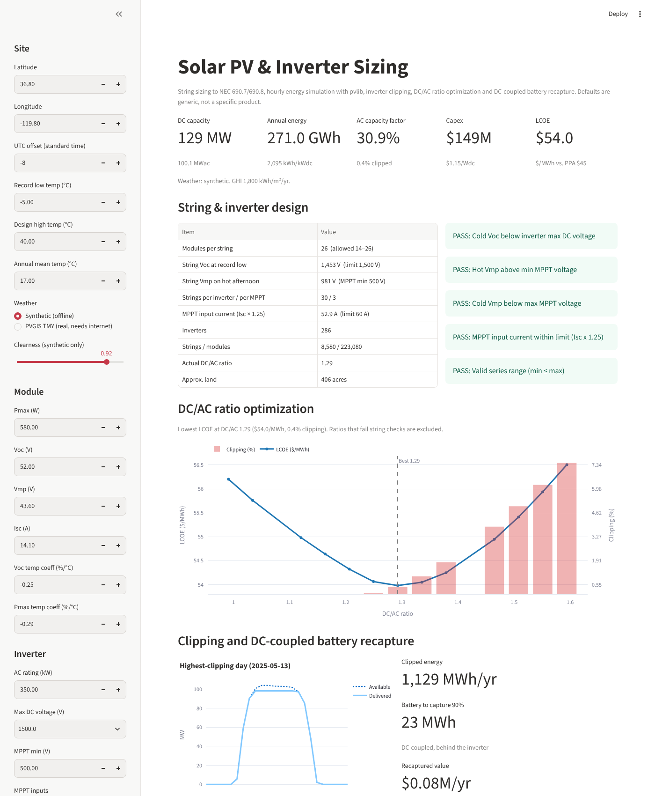
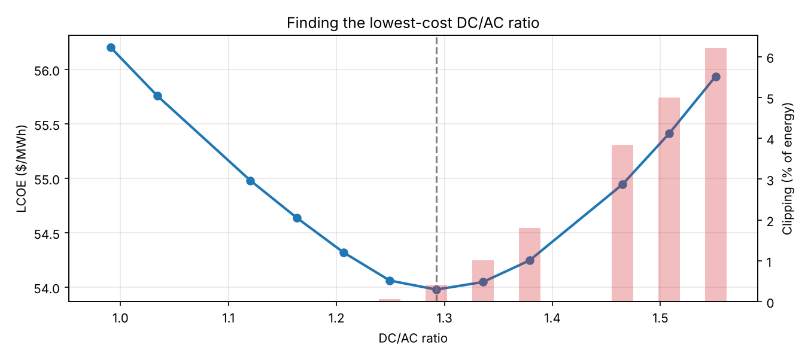
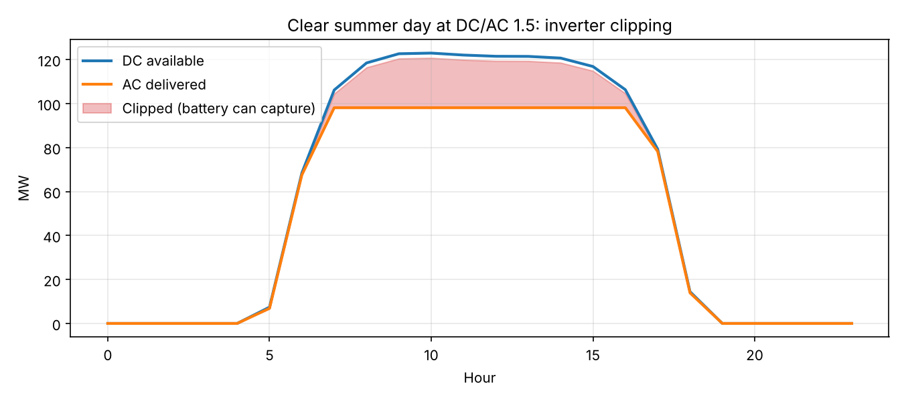

# Solar PV & Inverter Sizing Tool

A design tool for utility-scale and C&I solar: it sizes strings to code, picks the inverter count, simulates a year of hourly output, and finds the **DC/AC ratio with the lowest cost of energy**. It also shows how much clipped energy a **DC-coupled battery** could recover, which links solar design to storage.



## What it does

| Step | Method |
|---|---|
| **String sizing** | Max modules per string from cold-morning Voc at the record low temperature (NEC 690.7); min from hot-afternoon Vmp vs. the inverter's MPPT floor; MPPT input current checked at Isc × 1.25 (NEC 690.8) |
| **Plant layout** | Inverter count for the AC target, strings per inverter and per MPPT, total modules, actual DC/AC ratio, approximate land area |
| **Energy simulation** | Hourly for a full year using [pvlib](https://pvlib-python.readthedocs.io): sun position → single-axis tracker with backtracking (or fixed tilt) → Hay-Davies transposition → Faiman cell temperature → PVWatts DC and inverter models → clipping at the inverter AC rating |
| **DC/AC optimization** | Re-runs stringing, energy and LCOE from 1.0 to 1.6 and excludes designs that fail an electrical check |
| **Battery recapture** | Daily clipped energy → smallest DC-coupled battery that captures 90% of it, and what that energy is worth at evening prices |

## Findings: 100 MWac single-axis tracker, Central Valley, CA

- **String design:** 26 modules per string (cold Voc 1,453 V vs. the 1,500 V limit), 30 strings per 350 kW inverter, 3 per MPPT at 52.9 A (limit 60 A). 286 inverters, 223,080 modules, 129 MWdc, about 400 acres. All checks pass.
- **Energy:** 271 GWh/yr, 2,095 kWh/kWdc, 30.9% AC capacity factor. Trackers produce about 16% more energy than fixed tilt at this site (1,812 kWh/kWdc).
- **Optimal DC/AC ratio is about 1.29**, with an LCOE of $54/MWh and only 0.4% clipping. Below that, the fixed inverter and interconnection cost is spread over too few MWh. Above it, extra modules increasingly feed clipping.
- **At DC/AC 1.5,** clipping reaches about 5% (15.8 GWh/yr). A 127 MWh DC-coupled battery would recover 13.1 GWh/yr, worth about $1.2M/yr at $90/MWh. That doesn't pay for a battery on its own, but it is a free extra revenue stream for a battery bought for other reasons, which is why high DC/AC ratios and DC-coupled storage are often designed together.




## Run it

```bash
pip install -r requirements.txt
streamlit run app.py      # interactive tool
python run_example.py     # report + charts in docs/
python -m pytest          # tests
```

## Code layout

```
solar_model/
  config.py     site, module, inverter, design, losses, economics (every assumption commented)
  weather.py    synthetic year (pvlib clear-sky + cloudy days) or real PVGIS TMY
  strings.py    NEC string sizing and inverter loading checks
  simulate.py   hourly energy, clipping, battery recapture
  economics.py  capex, LCOE, NPV, DC/AC ratio sweep
```

## Assumptions and limits

- Module and inverter defaults are **generic** (a ~580 W TOPCon module and a 350 kW, 1500 V string inverter), not a specific product. Enter real datasheet values before using the results.
- **Synthetic weather** is conservative: about 1,800 kWh/m² of GHI vs. roughly 1,950 in measured data for this area. Choose PVGIS in the app for real typical-year weather (needs internet).
- Costs are illustrative 2026 US utility-scale round numbers.
- Not modeled: bifacial gain, row shading beyond backtracking, snow, spectral and IAM losses, curtailment, and tax credits.

## About

Built by **Sai Karri**, a PMP-certified project manager delivering utility-scale and C&I battery storage projects. Companion project: [BESS sizing for AI data centers](../bess-ai-datacenter-sizing).
